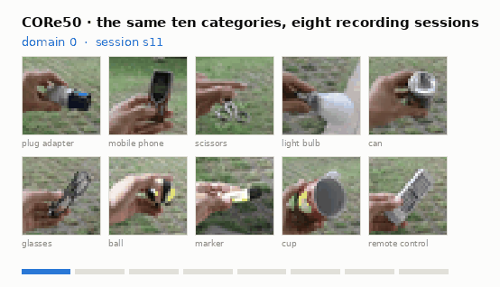
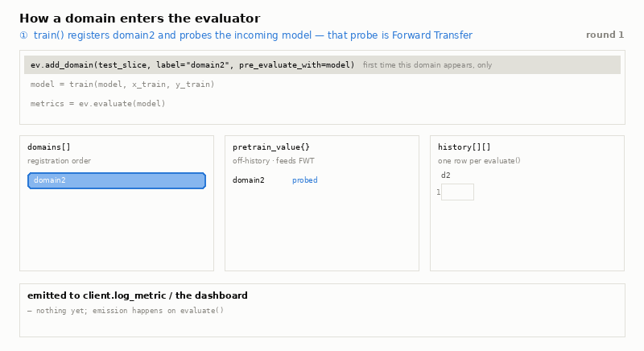
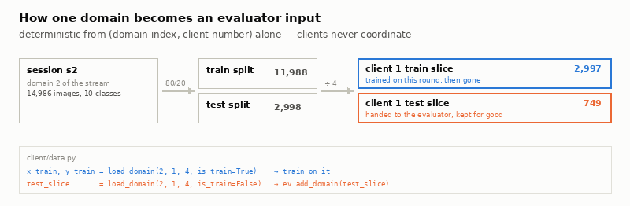
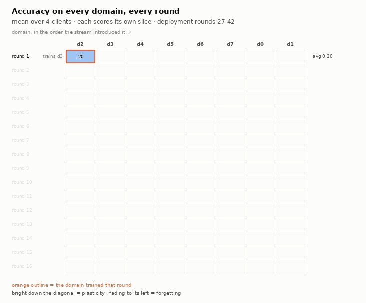
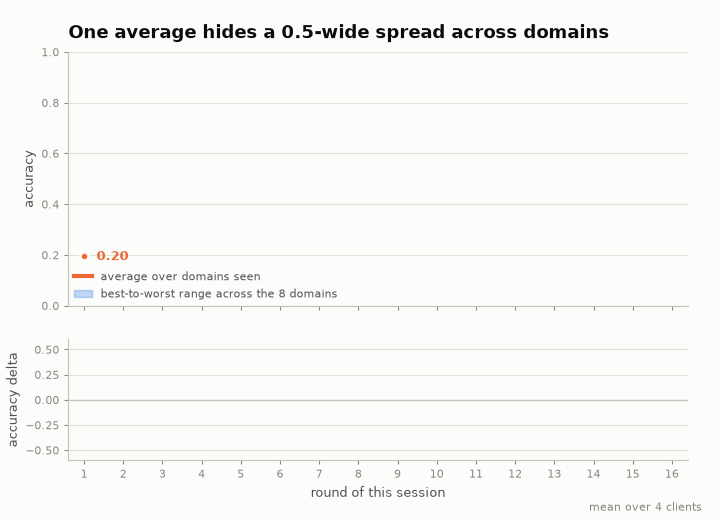
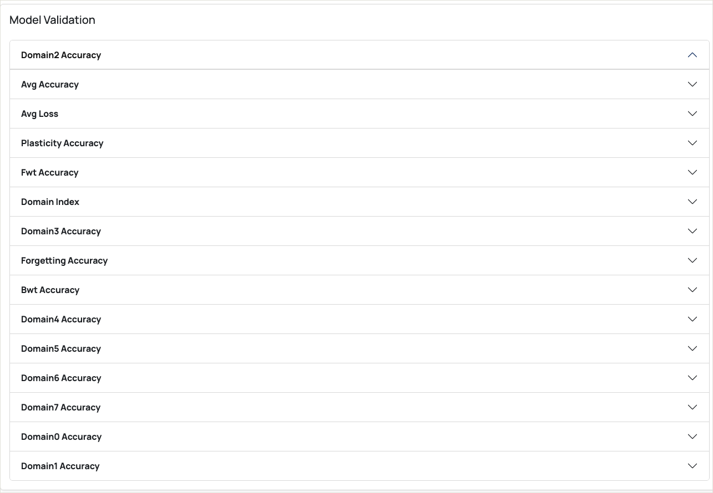
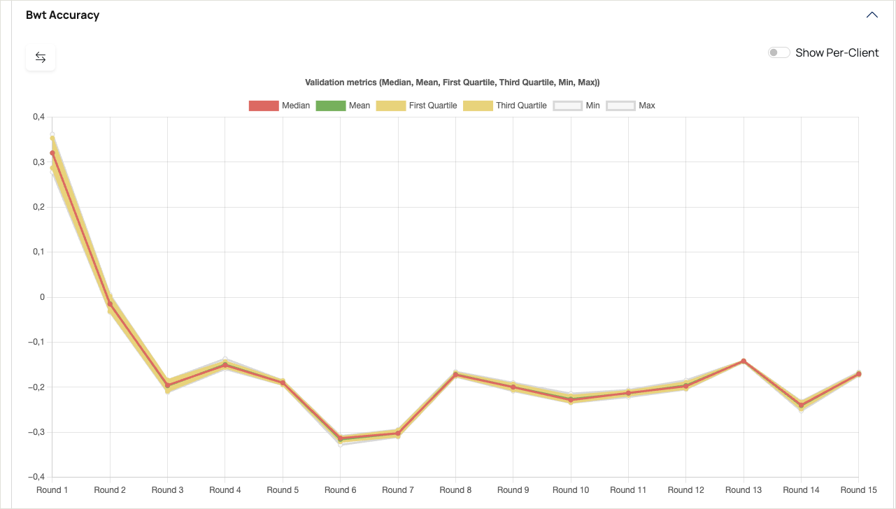
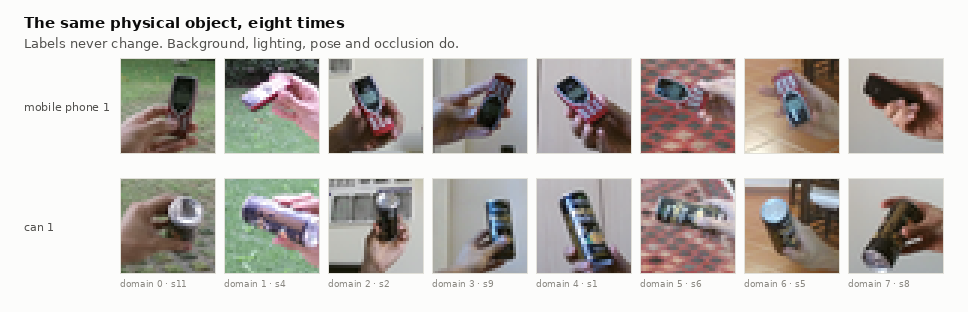

# Continual learning: measuring what a federated model forgets

This example trains a model across a stream of shifting domains and uses
Scaleout Edge's `ContinualLearningEvaluator` to track how well it keeps up with
new conditions, and how much it forgets about old ones.

<picture>
  <source media="(prefers-color-scheme: dark)" srcset="assets/01-domain-stream-dark.gif">
  
</picture>

The data is [CORe50](https://vlomonaco.github.io/core50/): the same ten object
categories, recorded in eight sessions with different backgrounds and lighting.
Each federated round, every client trains on the next session in the stream.

> **New to Scaleout Edge?** Start with the
> [MNIST quickstart](https://docs.scaleoutsystems.com/en/latest/quickstart.html),
> which covers projects, compute packages and sessions. This example assumes
> you're familiar with them.

## Why per-domain metrics

In real deployments the input distribution drifts: lighting changes, devices
move, sensors get replaced. A model fine-tuned on the newest data can keep a
good score on that data while getting steadily worse on everything it learned
before (*catastrophic forgetting*). A single accuracy number won't show this.

To see it you need accuracy **per domain, per round**. The evaluator keeps that
history and reduces it to a handful of metrics you can plot and alert on.

## Running the example

### Prerequisites

- [Python >=3.11, <3.14](https://www.python.org/downloads)
- About 5 GB of free disk space. On first run the clients download CORe50
  (~3.3 GB extracted, under `client/data/core50/`) and write preprocessed
  per-domain tensors (~1.4 GB, under `client/data/processed/`).

### Build the compute package and seed model

```sh
git clone https://github.com/scaleoutsystems/scaleout-client.git
cd scaleout-client/scaleout-client-python/examples/continual-learning
python -m venv .venv
source .venv/bin/activate
pip install scaleout

scaleout login <URL>

scaleout package create --path client
scaleout run install --path client      # builds the virtualenv, takes a few minutes
scaleout run build --path client        # writes seed.npz (~40 MB)

scaleout package set-active -f package.tgz -n continual-learning
scaleout model set-active -f seed.npz
```

### Start the clients

Create one enrollment token and use it for all clients:

```sh
scaleout client create-enrollment-token --name continual-learning
python run.py --api-url <URL> --enrollment-token <TOKEN> -n 4
```

`run.py` starts `-n` clients as subprocesses, gives each its own
`CLIENT_NUMBER`, and prefixes their logs with it. Training and validation are
serialized through a file lock, because four ResNet-18 clients running
concurrently on one machine will run out of memory. The first run downloads and
preprocesses the dataset; later runs reuse it.

### Start a session

```sh
scaleout session start -n continual-learning -r 16 -rc 4 -mc 4 -rt 1800 -v true
```

Sixteen rounds is two passes over the eight domains: the first pass shows
forgetting building up, the second shows recovery. Run
`scaleout session start --help` for what the other flags do.

### What to look for

- **Round 1:** only one domain has been scored. `forgetting_accuracy` and
  `bwt_accuracy` aren't in the payload yet.
- **Rounds 2–8:** forgetting and backward transfer appear and grow as more
  domains pile up on top of earlier ones.
- **Round 8:** every domain has been seen once, so all eight contribute to the
  aggregates from here on.
- **Rounds 9–16:** each domain is revisited. Compare its score on the second
  visit with the first.

## Using the evaluator

`ContinualLearningEvaluator` lives in `scaleoututil.evaluation`. It's
framework-agnostic: it never inspects your model or data, it just passes them
to a scoring function you provide.

```python
from scaleoututil.evaluation import ContinualLearningEvaluator

ev = ContinualLearningEvaluator(eval_fn=score, primary="accuracy")

ev.add_domain(test_slice, label="domain2", pre_evaluate_with=model)  # once per domain
metrics = ev.evaluate(model)                                         # once per round
```

`eval_fn(model, dataset)` returns a dict such as
`{"accuracy": ..., "loss": ...}`. It's the only part that knows about your
framework, so the same evaluator works with PyTorch, Keras or anything else.

<picture>
  <source media="(prefers-color-scheme: dark)" srcset="assets/04-evaluator-lifecycle-dark.gif">
  
</picture>

Internally the evaluator keeps three things:

- **Registered domains.** A domain is added the first round you train on it.
  Don't register all domains up front; that would set every domain's baseline
  to round 0 and make forgetting meaningless.
- **Pre-training scores.** With `pre_evaluate_with=model`, the incoming model is
  scored on the new domain before training on it. This is the forward transfer
  measurement.
- **A history matrix.** One row per `evaluate()` call, one column per domain.
  All the aggregate metrics are computed from it.

### Assumptions

The metrics are defined for the **domain-incremental** setting: the input
distribution changes between domains, but the set of labels doesn't. The
evaluator isn't designed for class-incremental streams (new classes over time)
or task-incremental ones (task identity given at test time), and it can't
detect if you're using one. It also assumes:

1. Domains arrive as a stream, and each is registered the round you first
   train on it.
2. `evaluate()` runs after training, so a domain's first score is its
   post-training baseline.
3. A single shared model is scored on every domain seen so far, every round.

With joint training (all domains available at once), the metrics still compute
but no longer mean anything.

## How the data is split

`add_domain()` takes whatever your `eval_fn` understands. In this example
that's an `(X, y)` tensor pair: one client's share of one domain's test split.

<picture>
  <source media="(prefers-color-scheme: dark)" srcset="assets/03-domain-pipeline-dark.png">
  
</picture>

Each client gets a `CLIENT_NUMBER` in `[0, TOTAL_N_CLIENTS)`. For each domain
it:

1. splits the domain 80/20 into train and test, using a fixed per-domain seed,
2. shuffles that split with a second fixed seed,
3. cuts it into `TOTAL_N_CLIENTS` equal slices and takes slice `CLIENT_NUMBER`.

This needs no coordination between clients. A given client always gets the
same slice, and no two clients share data. The train slice is used for one
round and then dropped (there is no replay). The test slice is kept by the
evaluator for the rest of the run, so later rounds can still score earlier
domains.

Domains are registered from `train()`, because it's the only callback that
receives a usable round number.

## Reading the results

The figures below come from a 16-round, 4-client run.

### The accuracy matrix

<picture>
  <source media="(prefers-color-scheme: dark)" srcset="assets/05-accuracy-matrix-dark.gif">
  
</picture>

Rows are rounds, columns are domains in the order they arrived. The outlined
cell in each row is the domain trained that round.

- **The diagonal is bright:** a domain scores well right after training on it.
- **Cells to the left fade:** earlier domains are forgotten as new ones arrive.
- **Cells to the right are empty:** a domain isn't scored until it has been
  registered.

For example, d2 starts at only 0.20 (one epoch from ImageNet weights). Training
on d3 in round 2 actually raises it to 0.52, so forgetting is negative in that
round (−0.32). From there d2 drops to 0.35 by round 8 as six more domains are
trained on top of it. In round 9 it's trained again and jumps to 0.97.

### Metrics

| Metric | What it measures | Key |
|---|---|---|
| Plasticity | Mean accuracy on each domain right after it was first trained. Stops changing once every domain has been seen (0.84 from round 8 here) | `plasticity_accuracy` |
| Forward transfer | Mean accuracy on each domain *before* it was first trained. Also fixed after the first pass (0.35 here) | `fwt_accuracy` |
| Forgetting | Mean drop from each past domain's best score to its current score | `forgetting_accuracy` |
| Backward transfer | Mean of current minus baseline score on past domains | `bwt_accuracy` |
| Average accuracy | Mean accuracy over all domains seen so far | `avg_accuracy` |

### Drift and recovery

<picture>
  <source media="(prefers-color-scheme: dark)" srcset="assets/06-drift-curves-dark.gif">
  
</picture>

After the first round, average accuracy stays between 0.56 and 0.70 for the
rest of the run. The spread between domains is much larger: in most rounds the
best and worst domain are about 0.5 apart. In the final round d1 is at 0.99 and
d3 at 0.49, while the average is 0.67.

Forgetting settles around 0.30 and backward transfer around −0.20. In other
words, past domains end up about 20 points below where they were right after
training.

Revisiting a domain recovers it. Every domain scores higher on its second visit
than on its first:

| Domain | d2 | d3 | d4 | d5 | d6 | d7 | d0 | d1 |
|---|---|---|---|---|---|---|---|---|
| 1st visit | 0.20 | 0.88 | 0.94 | 0.92 | 0.97 | 0.93 | 0.96 | 0.95 |
| 2nd visit | 0.97 | 0.95 | 0.99 | 0.98 | 0.99 | 0.98 | 0.99 | 0.99 |

Average accuracy is also higher at the end of the second pass (0.67) than at
the end of the first (0.58), though forgetting between visits is just as large.

## In the dashboard

Everything `validate()` returns appears in the Model Validation panel in
Scaleout Edge, next to the training curves:



Expand a metric to see it over the session, with the spread across clients.
Here backward transfer goes from positive to negative as the stream moves on:



The x-axis counts points in that metric's own series, not session rounds.
`bwt_accuracy` has no value in round 1, so its chart has 15 points and its
"Round 1" is session round 2.

Try **Show Per-Client** as well. Each client scores its own slice of every
domain, so a single client drifting away from the rest shows up there even
when the mean looks fine.

## The dataset

[CORe50](https://vlomonaco.github.io/core50/) contains 50 household objects in
10 categories, recorded in 11 sessions in different places and lighting. Its
"new instances" (NI) scenario uses 8 of those sessions for training, one
session per batch, which makes it a ready-made domain stream:

| Domain | 0 | 1 | 2 | 3 | 4 | 5 | 6 | 7 |
|---|---|---|---|---|---|---|---|---|
| Session | s11 | s4 | s2 | s9 | s1 | s6 | s5 | s8 |

> [!NOTE]
> This example splits each of the 8 training sessions 80/20 itself and doesn't
> use CORe50's held-out test sessions (s3, s7, s10). The numbers here aren't
> directly comparable to published CORe50 NI results.

The example uses `mini=True` (32×32 images; the figures are upscaled with
nearest-neighbour so you see what the network sees). The model is a ResNet-18
with ImageNet weights and a new 10-class head.

<details>
<summary>The same object across all eight domains</summary>

<picture>
  <source media="(prefers-color-scheme: dark)" srcset="assets/02-same-object-dark.png">
  
</picture>

</details>

### Which domain trains in which round

```python
domain_index = (round_id - 1) % NUM_DOMAINS   # NUM_DOMAINS = 8
```

`round_id` counts rounds across the whole deployment, not per session, so a
session usually starts partway through the cycle. The run shown here used
deployment rounds 27–42, so it started at domain `(27 - 1) % 8 = 2` and went
`2, 3, 4, 5, 6, 7, 0, 1` twice. Any 8 consecutive rounds still cover every
domain exactly once. The figures number rounds 1–16 within the session, as the
dashboard does.

## Known limitations

- **The round counter is deployment-wide**, so sessions usually don't start at
  domain 0 (see above).
- **Domain registration needs a numeric `round_id` in `train()`.** A training
  task without one raises an error instead of guessing. `validate()` doesn't
  register domains, because validation tasks don't carry a usable round number.
- **The compute lock is needed at this model size.** Without it, four
  ResNet-18 clients on one machine will exhaust memory.
- **No forgetting mitigation.** This is the naive baseline: plain sequential
  fine-tuning, with no replay or regularization.

## Extending the example

- **Use your own data.** `client/data.py` only needs to return `(X, y)`
  tensors per domain. Nothing else knows about CORe50.
- **Add a continual-learning strategy** such as replay, EWC or LwF, and compare
  `forgetting_accuracy` against this baseline.
- **Change the primary metric.** `ContinualLearningEvaluator(primary="f1")`
  produces `plasticity_f1`, `forgetting_f1` and so on. `primary` also accepts a
  list of metric names.
- **Add more clients.** `run.py -n 8` splits every domain eight ways.

## Reference

### Emitted metrics

`evaluate()` scores every registered domain and returns a flat dict:

- `{label}_{primary}` (e.g. `domain2_accuracy`): per-domain score, for primary
  metrics only.
- `avg_{key}` (e.g. `avg_accuracy`, `avg_loss`): mean across seen domains, for
  every key `eval_fn` returns.
- `plasticity_*`, `fwt_*`, `forgetting_*`, `bwt_*`: aggregates, for primary
  metrics only.

The example also logs `training_loss`, `training_accuracy` and `domain_index`
(the domain trained most recently) from `train()`.

### Where metrics are stored

Training metrics are written with `client.log_metric()` and stored in
`metrics`, with a `round_id`. Everything `validate()` returns, including all
continual-learning metrics, is stored in `validations` as one JSON object per
validation, **without** a `round_id`. Use `scaleout validation list` to see
them; they're not returned by `/api/v1/metrics`.

`tools/export_run.py` recovers round order by sorting validated `model_id`s by
first timestamp (each round's aggregated model is the next round's input), and
checks the result against `(round_id - 1) % 8`.

### Saving and restoring state

`save_state()` and `load_state()` persist the history matrix, each domain's
first-evaluation round and the pre-training scores, so history survives a
client restart. `eval_fn` and the datasets aren't saved; after `load_state()`,
pass `eval_fn` again and re-register each domain label.

## Regenerating the figures

All figures are generated from the dataset and a committed metrics export:

```sh
python tools/export_run.py --session-id <SID> --out assets/data/run.json
python tools/make_assets.py
```

`make_assets.py` renders a light and a dark version of each figure. It needs
`pillow`, `matplotlib` and `numpy`, which aren't in `client/python_env.yaml`
since the clients don't use them.

## Credits

CORe50 is by Vincenzo Lomonaco and Davide Maltoni, released under
[CC BY 4.0](https://creativecommons.org/licenses/by/4.0/):

> V. Lomonaco and D. Maltoni. *CORe50: a New Dataset and Benchmark for
> Continuous Object Recognition.* Proceedings of the 1st Annual Conference on
> Robot Learning, PMLR 78:17-26, 2017.

The dataset is downloaded with [Avalanche](https://avalanche.continualai.org/).